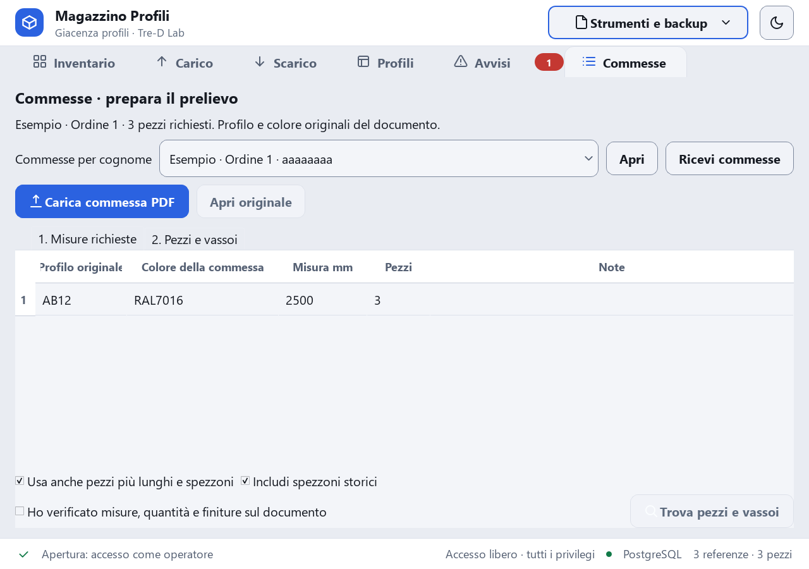
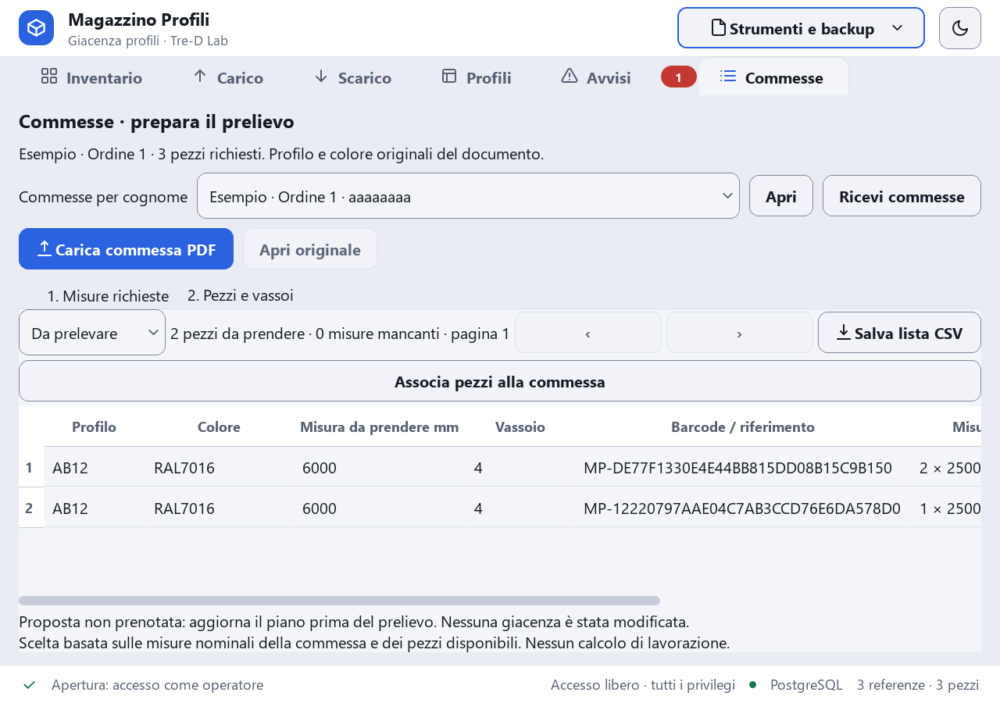
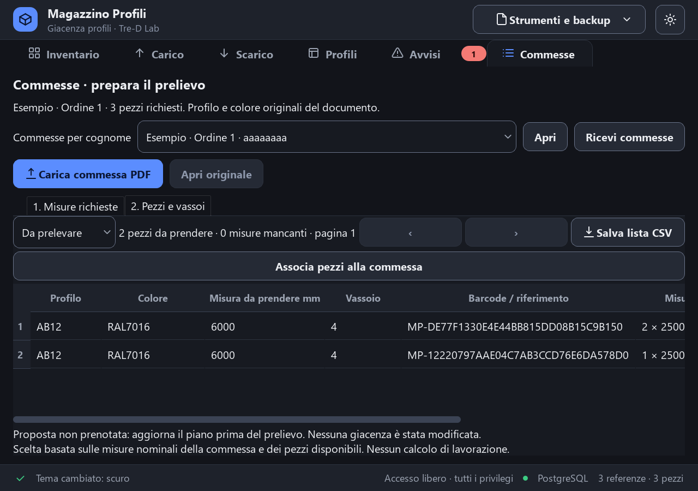
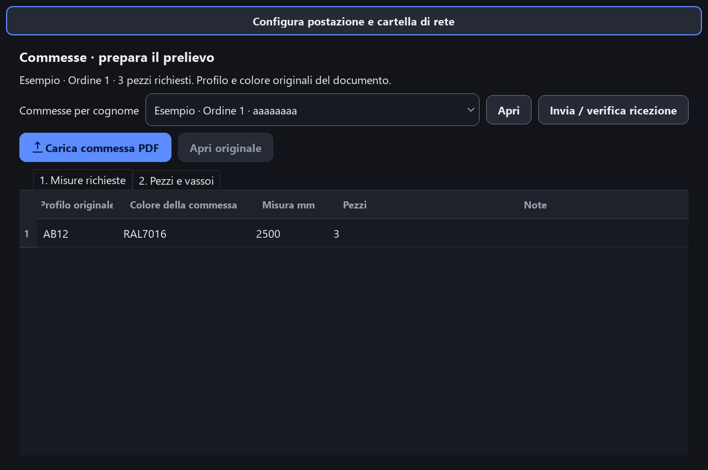

# Relazione 2.4.0 — commesse, postazioni e distribuzione

## Esito e confini della verifica

**VERIFICATO:** lettura estesa delle commesse, archivio per cognome, colori originali immutabili, trasferimento tramite cartella condivisa, aggiornamento ZIP firmato ed eseguibile Windows sono implementati. Le prove sono avvenute su copie esterne e database sintetici, senza migrare il magazzino operativo. Evidenze: `docs/ESITI_TEST_2.4.0.json:1` e riferimenti nelle sezioni seguenti.

**NON VERIFICATO su dispositivi reali:** due PC con SMB, VM Windows pulita, hardware da 4 GB e fotocamera del telefono. Non equiparare la prova dell’eseguibile su questo PC a una certificazione su tutti i PC. Il principale richiede PostgreSQL già disponibile; il secondario funziona senza database. Evidenze: `README.md:15`, `docs/ESITI_TEST_2.4.0.json:1`.

## Passo A — analisi iniziale, senza modifiche

Il lettore esistente era `magazzino_profili/services/lettura_commessa.py`, funzione `leggi_commessa_pdf`: interpretazione locale di Liste ottimizzate Blitz, testo PDF e OCR Windows delle quote raster. Nella copia 2.3.0 conservata per il confronto il codice era limitato da una regex delle famiglie, mancava il cognome nel documento e la scheda manteneva una sola commessa in memoria. La nuova implementazione mantiene la struttura Blitz e rimuove il vincolo sulle famiglie; non è un lettore universale di qualunque impaginazione PDF. Evidenze del codice attuale: `magazzino_profili/services/lettura_commessa.py:83`, `magazzino_profili/services/lettura_commessa.py:19`.

Nel formato fornito il cognome compare dopo **Rif.** nella riga dell’ordine; `Cliente` contiene invece un numero e non viene usato come cognome. Sono supportati anche `Cognome:` e `Riferimento:`. Campo mancante o presente ma vuoto: rifiuto prima delle scritture. Evidenza e test riproducibile con dati inventati: `magazzino_profili/services/lettura_commessa.py:28`, `magazzino_profili/tests/test_commesse_multiple.py:17`.

La valutazione iniziale ha distinto cache/output rigenerabili da strumenti manuali e dati da conservare. Nessun file applicativo è stato considerato eliminabile per il solo fatto di non avere import Python: script CLI, risorse e documentazione possono essere usati fuori dal grafo degli import. La lista effettivamente approvata e poi eliminata è riportata sotto, con inventario in `docs/PULIZIA_APPROVATA_2.4.0.json:1`.

Il file `magazzino-mockup-grande.html` citato nelle specifiche non è stato reperito nel checkout. **NON VERIFICABILE** un confronto diretto con quel file. Sono stati riutilizzati tema, componenti e scheda Commesse esistenti; le quattro anteprime allegate mostrano dati sintetici. Evidenze: `_prompt_fase5.md:3`, `magazzino_profili/ui/scheda_commesse.py:20`.

## Passo B — decisioni approvate

| Decisione | Soluzione | Motivazione e limite |
|---|---|---|
| Vista commesse | Elenco dentro la scheda Commesse, cognome + ordine + identificativo breve | Mantiene l’organizzazione già presente; nessuna nuova schermata di magazzino. |
| Trasporto | Cartella condivisa Windows/NAS | File durevoli e nessun servizio HTTP nuovo; richiede permessi SMB e percorso raggiungibile. Se la cartella è sul principale spento, si conserva la copia locale e si riprova. |
| Alternativa non adottata | Server HTTP LAN | Risposta immediata e centralizzazione; richiederebbe servizio acceso, gestione firewall e tentativi offline. |
| Aggiornamenti | GitHub Releases `Si2008/Magazzino`, manifest Ed25519 e SHA-256 | Link stabile alla release più recente, download pubblico, chiave privata esclusa. |
| Pulizia | Solo cache, vecchia build, file vuoto `nul`, directory vuote | Nessuna eliminazione di backup, immagini, configurazioni o strumenti incerti. |

Le scelte sono state confermate dall’utente in chat. La firma del manifest è applicativa: **non è una firma Authenticode dell’EXE**. Riferimenti: `README.md:1`, `tools/prepara_release.py:1`.

## Passo C — implementazione e compatibilità

### Lettura, identità e validazione

Codici e colori sono conservati come nel documento e non validati contro il catalogo. Restano obbligatori i controlli strutturali: limiti di dimensione/pagine/righe, campi non vuoti, misure e quantità positive. OCR non disponibile, quote dubbie o struttura incompleta provocano il rifiuto dell’intera importazione: nessun ripiego silenzioso sulle misure nominali. La lettura non scrive nel database. Evidenze: `magazzino_profili/services/lettura_commessa.py:83`, `magazzino_profili/services/commesse.py:1`, `magazzino_profili/tests/test_commesse.py:1`.

Il cognome normalizzato raggruppa; l’identità semantica del documento distingue ordini diversi. Stesso contenuto rinominato o rigenerato senza variazioni semantiche: nessun duplicato. Stesso cognome e documento diverso: conferma per aggiungerlo al gruppo, senza sostituzione. Stessa identità con contenuto differente: rifiuto. Advisory lock PostgreSQL e transazione unica proteggono gli import simultanei. Evidenze: `magazzino_profili/services/archivio_commesse.py:76`, `magazzino_profili/services/archivio_commesse.py:19`.

La compatibilità riguarda il layout Blitz già usato e i primi quattro campi di `DocumentoCommessa`. La 2.3 non aveva archivio commesse persistente: i PDF vanno reimportati. Le vecchie tabelle e migrazioni non sono riscritte; `012_commesse.sql` aggiunge Commesse, RigheCommessa e Assegnazioni. Il backup Excel formato 4 include le tre tabelle e ripristina anche i formati precedenti. Evidenze: `migrations/012_commesse.sql:1`, `magazzino_profili/domain/commessa.py:1`, `magazzino_profili/reports/backup_excel.py:349`.

### Pezzi e colore

Nessun selettore colore è disponibile nella commessa. Il magazzino viene interrogato con corrispondenza esatta e univoca del codice o nome colore; una finitura sconosciuta/ambigua risulta mancante, senza sostituzioni approssimate. Il risultato indica misura effettiva da prendere, vassoio, barcode e richieste coperte. Nessuna dimensione lama entra nel calcolo. Evidenze: `magazzino_profili/services/commesse.py:1`, `magazzino_profili/ui/scheda_commesse.py:194`, `magazzino_profili/ui/scheda_commesse.py:264`.

L’associazione è esplicita e non scarica il pezzo. È unica per pezzo e rimane dopo lo scarico; il pezzo non viene suggerito per un’altra commessa. Il nuovo carico può ricevere una commessa nella stessa transazione. Cognome visibile in dettaglio inventario e scarico. Gli spezzoni storici senza barcode proprio non sono assegnabili automaticamente: prima occorre identificarli fisicamente. Evidenze: `magazzino_profili/services/archivio_commesse.py:124`, `magazzino_profili/services/archivio_commesse.py:105`, `magazzino_profili/services/pezzi_unitari.py:1`, `magazzino_profili/ui/scheda_carico.py:1`, `magazzino_profili/ui/scheda_scarico.py:1`, `magazzino_profili/ui/tabella_pezzi.py:1`.

### Scambio e postazioni

Il secondario mantiene copie atomiche locali in `%LOCALAPPDATA%/magazzino_profili/commesse_secondario`, senza aprire il database. JSON versione 1, dimensioni limitate, identità e cognome inclusi. La cartella di rete contiene invii e ricevute, non il database. Le preferenze del ruolo/percorso sono locali QSettings. Evidenze: `magazzino_profili/services/postazione.py:1`, `magazzino_profili/services/archivio_commesse.py:139`, `magazzino_profili/services/archivio_commesse.py:40`.

**Invia / verifica ricezione** pubblica dal secondario; **Ricevi commesse** importa sul principale. La ricezione è comandata dal pulsante, non da polling automatico. Invio non significa accettazione: viene mostrata la ricevuta. Rete assente o principale irraggiungibile: errore chiaro e copia locale preservata. Omonimie pendenti possono essere riprese; una ricevuta di rifiuto espone il motivo e permette un nuovo invio della copia valida. Evidenze: `magazzino_profili/services/sincronizza_commesse.py:1`, `magazzino_profili/ui/scheda_commesse.py:141`, `magazzino_profili/tests/test_commesse_multiple.py:1`.

### Aggiornamento

La versione è letta da `magazzino_profili/__init__.py:1`. Feed GitHub predefinito, verifica firma e checksum, estrazione in una nuova cartella, installazione nel thread di lavoro e riavvio. Traversal, symlink, nomi Windows riservati, duplicati e ZIP troppo grandi sono rifiutati. Evidenze: `magazzino_profili/services/aggiornamenti.py:1`, `magazzino_profili/services/pacchetto_aggiornamento.py:1`, `magazzino_profili/ui/dialogo_aggiornamento.py:1`, `magazzino_profili/tests/test_aggiornamento_zip.py:1`.

**Passaggio dalla 2.3 alla 2.4: estrazione manuale del nuovo ZIP oppure uso della nuova cartella consegnata sul Desktop.** Il vecchio updater copiava un solo EXE e non può installare correttamente questo pacchetto di librerie. Dalla 2.4 il formato ZIP completo è supportato. Non è stato pubblicato un finto installer monofile.

### File nuovi o modificati rispetto alla consegna 2.3

Sono segnalati anche gli interventi sui percorsi già verificati. Non sono stati cambiati i modelli preesistenti Pezzo/Movimento né riscritte le vecchie migrazioni per questa fase. Il working tree conteneva inoltre modifiche di fasi precedenti: l’elenco seguente usa il confronto con la copia di consegna 2.3, non soltanto `git status`.

| File | Tipo | Motivo |
|---|---|---|
| `magazzino_profili/__init__.py:1` | Modificato | Versione unica 2.4.0. |
| `magazzino_profili/domain/__init__.py:1` | Modificato | Registrazione ed esportazione dei nuovi modelli. |
| `magazzino_profili/domain/commessa.py:1` | Nuovo | Modelli persistenti di commessa, righe e associazioni ai pezzi. |
| `magazzino_profili/main.py:1` | Modificato | Scelta postazione prima dell’apertura del database; secondario senza magazzino. |
| `magazzino_profili/reports/backup_excel.py:1` | Modificato | Formato 4 con commesse e associazioni; lettura dei backup precedenti. |
| `magazzino_profili/services/aggiornamenti.py:1` | Modificato | Feed GitHub predefinito e pacchetto completo verificato. |
| `magazzino_profili/services/archivio_commesse.py:1` | Nuovo | Persistenza, identità, omonimie, transazioni e archivio secondario. |
| `magazzino_profili/services/commesse.py:1` | Modificato | Testi originali, corrispondenza colore esatta e filtro assegnazioni. |
| `magazzino_profili/services/consultazione.py:1` | Modificato | Cognome della commessa nel dettaglio dei pezzi, con lettura in blocco. |
| `magazzino_profili/services/lettura_commessa.py:1` | Modificato | Cognome, profili senza catalogo, identità semantica e rifiuto letture incomplete. |
| `magazzino_profili/services/pacchetto_aggiornamento.py:1` | Nuovo | Estrazione del pacchetto firmato con controlli sui percorsi Windows. |
| `magazzino_profili/services/pezzi_unitari.py:1` | Modificato | Associazione facoltativa del nuovo pezzo nella transazione di carico. |
| `magazzino_profili/services/postazione.py:1` | Nuovo | Impostazioni locali di ruolo e rete, archivio locale del secondario. |
| `magazzino_profili/services/sincronizza_commesse.py:1` | Nuovo | Trasferimento atomico tramite cartella e ricevute persistenti. |
| `magazzino_profili/tests/test_aggiornamento_zip.py:1` | Nuovo | Test automatici e aspettative aggiornate alle nuove funzioni. |
| `magazzino_profili/tests/test_backup_excel.py:1` | Modificato | Test automatici e aspettative aggiornate alle nuove funzioni. |
| `magazzino_profili/tests/test_commesse.py:1` | Modificato | Test automatici e aspettative aggiornate alle nuove funzioni. |
| `magazzino_profili/tests/test_commesse_multiple.py:1` | Nuovo | Test automatici e aspettative aggiornate alle nuove funzioni. |
| `magazzino_profili/tests/test_dialogo_aggiornamento.py:1` | Modificato | Test automatici e aspettative aggiornate alle nuove funzioni. |
| `magazzino_profili/tests/test_sicurezza_fase14.py:1` | Modificato | Test automatici e aspettative aggiornate alle nuove funzioni. |
| `magazzino_profili/ui/dialogo_aggiornamento.py:1` | Modificato | Preparazione del pacchetto nel thread di lavoro. |
| `magazzino_profili/ui/finestra_principale.py:1` | Modificato | Voce di configurazione postazione, senza riorganizzare le altre schede. |
| `magazzino_profili/ui/postazione.py:1` | Nuovo | Configurazione e finestra per il secondario senza database. |
| `magazzino_profili/ui/scheda_carico.py:1` | Modificato | Scelta della commessa per un nuovo pezzo. |
| `magazzino_profili/ui/scheda_commesse.py:1` | Modificato | Elenco per cognome, colori non modificabili, import/invio/ricezione e associazioni. |
| `magazzino_profili/ui/scheda_scarico.py:1` | Modificato | Cognome nel riepilogo, con escaping HTML. |
| `magazzino_profili/ui/tabella_pezzi.py:1` | Modificato | Commessa nel dettaglio del pezzo in inventario. |
| `migrations/012_commesse.sql:1` | Nuovo/modificato | Migrazione additiva: tre tabelle, chiavi esterne, indici e univocità. |
| `config.example.toml:1` | Nuovo/modificato | Esempio generico con aggiornamenti GitHub, senza credenziali reali. |
| `MagazzinoProfili.spec:1` | Nuovo/modificato | Metadati della versione generati dalla fonte unica; risorse frozen. |
| `version_info.txt:1` | Nuovo/modificato | Promemoria: la versione è generata dal comando di build. |
| `tools/compila_windows.py:1` | Nuovo/modificato | Build in cartella nuova, versione unica e configurazione di esempio. |
| `tools/prepara_release.py:1` | Nuovo/modificato | ZIP completo senza dati e manifest firmato Ed25519. |
| `README.md:1` | Nuovo/modificato | Installazione, configurazione, scambio commesse, aggiornamento e build. |
| `docs/RELAZIONE_2.4.0.md:1` | Nuovo | Analisi, scelte, modifiche, prove e limiti. |
| `docs/ESITI_TEST_2.4.0.json:1` | Nuovo | Risultati consolidati dei test, senza doppio conteggio dei retest. |
| `docs/PULIZIA_APPROVATA_2.4.0.json:1` | Nuovo | Registro delle eliminazioni autorizzate. |
| `docs/commesse_240_*.png` | Nuovi | Quattro anteprime con dati inventati, tema chiaro/scuro e secondario. |

### Eliminazioni approvate eseguite

| Percorso | File contenuti | Motivo |
|---|---:|---|
| `__pycache__` | 5 | Cache rigenerabile |
| `fase6-file-modificati/magazzino_profili/tests/__pycache__` | 4 | Cache rigenerabile |
| `firme/__pycache__` | 1 | Cache rigenerabile |
| `magazzino_profili/__pycache__` | 3 | Cache rigenerabile |
| `magazzino_profili/backup/__pycache__` | 2 | Cache rigenerabile |
| `magazzino_profili/barcode/__pycache__` | 4 | Cache rigenerabile |
| `magazzino_profili/db/__pycache__` | 6 | Cache rigenerabile |
| `magazzino_profili/domain/__pycache__` | 9 | Cache rigenerabile |
| `magazzino_profili/reports/__pycache__` | 8 | Cache rigenerabile |
| `magazzino_profili/services/__pycache__` | 18 | Cache rigenerabile |
| `magazzino_profili/sicurezza/__pycache__` | 2 | Cache rigenerabile |
| `magazzino_profili/tests/__pycache__` | 113 | Cache rigenerabile |
| `magazzino_profili/ui/__pycache__` | 17 | Cache rigenerabile |
| `magazzino_profili/web/__pycache__` | 6 | Cache rigenerabile |
| `build` | 14 | Output build precedente |
| `.pytest_cache` | 5 | Cache rigenerabile |
| `scan_work/at40_standard_test` | 0 | Directory vuota |
| `scan_work/at40_std_candidates` | 0 | Directory vuota |
| `scan_work/at40_to_candidates` | 0 | Directory vuota |
| `scan_work/at45_candidates` | 0 | Directory vuota |
| `scan_work/general_nc_candidates` | 0 | Directory vuota |
| `scan_work/profile_candidates` | 0 | Directory vuota |
| `scan_work/woodslide_candidates` | 0 | Directory vuota |

Il file `nul` è ancora presente e misura **90 byte** alla verifica finale: non è più un file vuoto, quindi non è stato eliminato con l’autorizzazione limitata al file vuoto. Le altre directory `scan_work` non vuote restano conservate. Configurazioni, backup, risorse, documentazione, vecchie release e strumenti manuali sono stati conservati. Evidenza delle eliminazioni effettive: `docs/PULIZIA_APPROVATA_2.4.0.json:1`.

## Passo D — build, prove e installazione

Build Windows x64 con Python 3.14.7, PySide6 6.12.0 e PyInstaller 6.22.3 nell’ambiente virtuale locale, senza installazioni globali. Distribuzione in cartella per evitare l’estrazione delle librerie a ogni avvio; 211 PNG inclusi. Comandi e dipendenze: `README.md:1`, `requirements.lock.txt:1`, `tools/compila_windows.py:1`, `MagazzinoProfili.spec:1`.

| Prova | Stato | Risultato / motivo |
|---|---|---|
| Suite Python consolidata | SUPERATO | 737 casi distinti, dopo i retest; nessun fallimento finale. |
| Casi saltati | NON ESEGUITO | 1; motivi per ciascun caso nel JSON, non contati come superati. |
| Otto importazioni PostgreSQL simultanee | SUPERATO | Una sola commessa creata; omonimia bloccata senza conferma. |
| Migrazione, associazione dopo scarico, backup/ripristino PG | SUPERATO | Database temporanei separati; nessun DB operativo usato. |
| PDF già fornito, OCR locale | SUPERATO | 35 barre, 8 codici, 21 combinazioni, 151 pezzi, nessun fallback; circa 1,499 s su questo PC. |
| UI chiara/scura e secondario | SUPERATO | Anteprime verificate; colore non modificabile; elenco multiplo. |
| Eseguibile frozen desktop/telefono | SUPERATO | Avvio server circa 2,128 s; barcode unitari, idempotenza, immagine e scarico; PATH senza Python. |
| ZIP reale firmato e avvio estratto | SUPERATO | Firma, SHA-256, 211 PNG e installazione ripetibile; esito nel JSON. |
| Due PC fisici, SMB reale | NON ESEGUITO | Serve la rete e la condivisione configurata sulle postazioni reali. |
| VM pulita / PC vecchio 4 GB | NON ESEGUITO | Ambiente non disponibile; checklist in README. |
| Fotocamera telefono reale in questa fase | NON ESEGUITO | Nessun dispositivo reale collegato per questa fase. |
| Test bloccati alla fine | BLOCCATO | Nessun blocco residuo dei test eseguibili nell’ambiente disponibile. |

Gli errori delle prime esecuzioni non sono nascosti: conversione del risultato SQL in dizionario corretta usando `.all()`; aspettative di test aggiornate per il feed GitHub abilitato, per la scheda Commesse già esistente e per le otto tabelle di backup. I retest finali hanno superato questi casi. L’OCR continua a richiedere verifica umana delle quote, anche quando la prova automatica passa. Evidenze: `docs/ESITI_TEST_2.4.0.json:1`, `magazzino_profili/tests/test_commesse.py:1`.

### Installazione e aggiornamenti

1. Scaricare la [release 2.4.0](https://github.com/Si2008/Magazzino/releases/tag/v2.4.0) ed estrarre tutto lo ZIP. Non avviare l’EXE da dentro lo ZIP.
2. Principale: selezionare il TOML del database esistente; conservare il backup prima della migrazione. Il pacchetto non installa PostgreSQL e non include credenziali.
3. Secondario: scegliere il ruolo oppure avviare con `--secondario`; configurare la stessa cartella UNC del principale e riavviare dopo un cambio di ruolo.
4. Importare, inviare dal secondario e ricevere dal principale; verificare la ricevuta. Il semplice file in cartella non equivale a importazione ufficiale.
5. Dalle versioni successive alla 2.4 usare l’avviso aggiornamenti. Per il passaggio iniziale 2.3→2.4 usare il pacchetto completo manuale.

### Problemi aperti e limiti espliciti

- Layout PDF diversi da Blitz richiedono un campione e un lettore dedicato; non sono stati promessi né indovinati.
- Rilascio di un’associazione o rettifica dell’identità di una commessa già registrata non hanno una nuova UI in questa fase: niente riassegnazione silenziosa.
- La cartella condivisa è affidata ai permessi Windows dei PC autorizzati. Non introduce autenticazione applicativa, come richiesto.
- Il principale deve essere disponibile per accettare le commesse; l’archivio locale protegge il lavoro quando rete o PC non sono disponibili.
- Non sono state simulate interruzioni elettriche né certificate le semantiche atomiche di ogni NAS. Verificare sul NAS effettivo prima dell’uso operativo.
- Repo pubblico e firma del manifest non sostituiscono la firma Authenticode; Windows può mostrare SmartScreen.

## Anteprime con dati sintetici

## Riferimenti tecnici ufficiali

[Link stabili GitHub Releases](https://docs.github.com/en/repositories/releasing-projects-on-github/linking-to-releases), [modalità PyInstaller](https://pyinstaller.org/en/stable/operating-mode.html), [comandi PyInstaller](https://pyinstaller.org/en/stable/usage.html).
